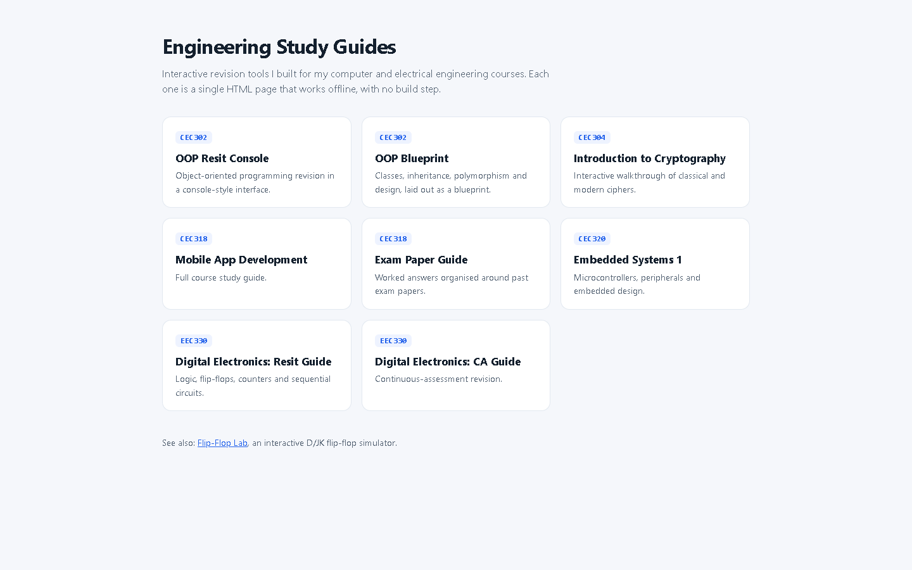
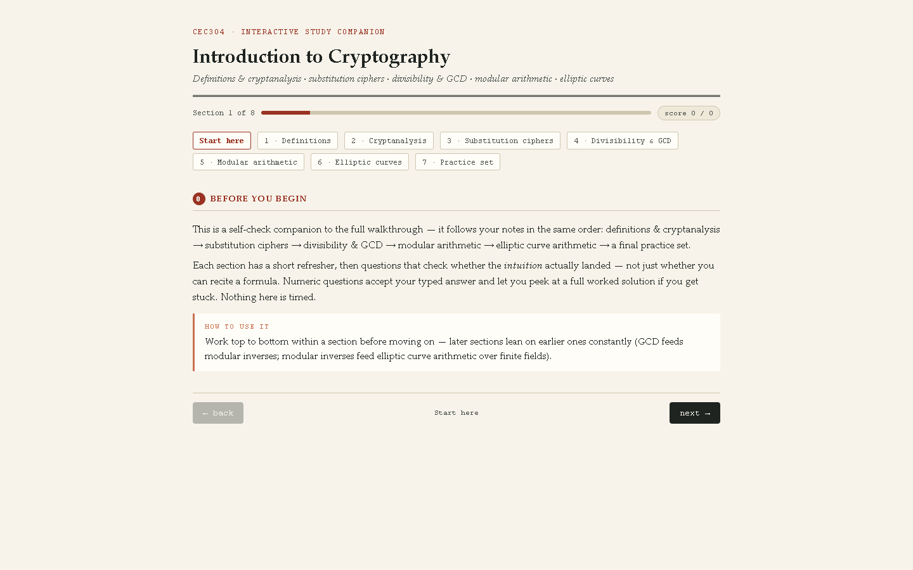

# Engineering Study Guides

Interactive revision tools I built for my computer and electrical engineering courses. Each guide is a single HTML page that works offline, with self-check questions, worked solutions and progress tracking.

**[Open the collection →](https://wrightmua.github.io/engineering-study-guides/)**

| Course | Guide |
|---|---|
| CEC302 Object-Oriented Programming | [OOP Resit Console](guides/cec302-oop-console.html) · [OOP Blueprint](guides/cec302-oop-blueprint.html) |
| CEC304 Introduction to Cryptography | [Interactive study companion](guides/cec304-cryptography.html) |
| CEC318 Mobile App Development | [Study guide](guides/cec318-mobile-app-dev.html) · [Exam paper guide](guides/cec318-exam-paper-guide.html) |
| CEC320 Embedded Systems 1 | [Study guide](guides/cec320-embedded-systems.html) |
| EEC330 Digital Electronics | [Resit guide](guides/eec330-digital-electronics-resit.html) · [CA guide](guides/eec330-digital-electronics-ca.html) |

Related: [Flip-Flop Lab](https://github.com/Wrightmua/flip-flop-lab), an interactive D/JK flip-flop simulator for EEC330.
